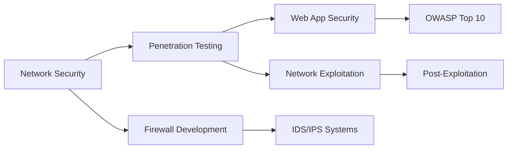

<div align="center">

# 👋 Hi, I'm Rahul R
  
### 🔐 Cybersecurity Enthusiast | Ethical Hacker in Training | AI & Data Science Student

[](https://www.linkedin.com/in/rahulr)
[](mailto:rahulr@example.com)
[](https://github.com/DarkAssassin007)

</div>

---

## 🎯 About Me

```python
class CybersecurityEnthusiast:
    def __init__(self):
        self.name = "Rahul R"
        self.role = "Aspiring Cybersecurity Analyst & Ethical Hacker"
        self.education = "B.Tech - AI & Data Science (3rd Year)"
        self.location = "Karur, Tamil Nadu, India"
        self.certifications = ["PGDCA", "SQL & RDBMS 101 (Cognizant.AI)"]
        self.learning = ["CEH Preparation", "Firewall Development", "Network Defense"]
        self.interests = ["Network Security", "Penetration Testing", "Threat Intelligence"]
        
    def current_focus(self):
        return [
            "Building Secure Systems",
            "Ethical Hacking Techniques",
            "Security Automation with Python",
            "Network Traffic Analysis"
        ]
```

### 🎓 Current Pursuits
- 🔒 Preparing for **Certified Ethical Hacker (CEH)** certification
- 🧱 Developing advanced firewall and network security solutions
- 🐛 Exploring vulnerability assessment and penetration testing
- 🤖 Integrating AI/ML with Cybersecurity applications
- 💼 Seeking **remote internships** in Cybersecurity and Security Research

---
<!--
## 🛡️ Featured Project

### 🔥 **Parental Firewall – Intelligent Home Network Content Filter**

A sophisticated layer-7 firewall that provides real-time content filtering and threat protection for home networks, protecting families from malicious and inappropriate content.

**Key Features:**
- 🚦 Real-time packet inspection and filtering
- 🎯 Deep packet inspection (DPI) for content analysis
- 📊 Traffic monitoring dashboard with live statistics
- 🔍 Regex-based pattern matching for URL/content filtering
- 📝 Comprehensive logging and alert system
- ⚙️ Customizable rule engine for fine-grained control

**Technology Stack:**
```
Backend: Python (Socket Programming, Scapy, Threading)
Analysis: Wireshark, tcpdump
System Integration: Windows API, Registry Management
Pattern Matching: Regex, DNS Filtering
UI: Tkinter, Custom Dashboard
```

**My Contributions:**
- Architected the packet filtering engine with multi-threaded processing
- Implemented real-time DPI for HTTP/HTTPS traffic analysis
- Designed rule-based filtering system with dynamic updates
- Created comprehensive logging and reporting mechanisms
- Built intuitive GUI for non-technical users

[View Project →](https://github.com/DarkAssassin007/parental-firewall)
-->
---

## 🛠️ Cybersecurity Arsenal

### 🔐 Security Tools & Frameworks

#### Penetration Testing & Exploitation


#### Network Analysis & Monitoring


#### Web Application Security


#### Security Frameworks & Standards


### 💻 Programming & Scripting


### 🧠 AI/ML for Security


### 🗄️ Databases & Web Technologies


### 🖥️ Operating Systems & Platforms


### ⚙️ Development Tools


---

## 📚 Learning Roadmap

### 🎯 Current Focus Areas



### 📖 Active Learning
- ✅ **Network Security**: TCP/IP, OSI Model, Network Protocols
- ✅ **Python for Security**: Socket Programming, Scapy, Automation
- 🔄 **CEH Preparation**: Ethical Hacking methodologies and tools
- 🔄 **Web Application Security**: OWASP Top 10, XSS, SQL Injection
- 📝 **Malware Analysis**: Static and Dynamic Analysis techniques
- 📝 **Digital Forensics**: Evidence collection and analysis
- 📝 **Cloud Security**: AWS/Azure security best practices

### 🎓 Planned Certifications
- 🎯 **Certified Ethical Hacker (CEH)** - In Progress
- 📋 **CompTIA Security+**
- 📋 **Offensive Security Certified Professional (OSCP)**
- 📋 **GIAC Security Essentials (GSEC)**

---

## 📊 GitHub Statistics

<div align="center">
  


</div>

---

## 🏆 Certifications & Achievements

| Certification | Issuer | Year |
|--------------|--------|------|
| 🎓 Post Graduate Diploma in Computer Applications | PGDCA | 2023 |
| 📊 SQL & RDBMS 101 | Cognizant.AI | 2024 |
| 🔐 Cybersecurity Fundamentals | *(In Progress)* | 2025 |
| ⚔️ Certified Ethical Hacker (CEH) | *(Preparing)* | 2025 |

---

## 💼 Experience & Projects

### 🔬 Security Research & Development
- 🛡️ **Home Network Security**: Developing parental control and content filtering solutions
- 🐍 **Security Automation**: Python scripts for vulnerability scanning and monitoring
- 🔍 **Traffic Analysis**: Deep packet inspection and anomaly detection systems
- 📊 **Threat Intelligence**: Analyzing network patterns and security threats

### 🎯 Hands-On Practice
- 💻 **CTF Challenges**: Participating in Capture The Flag competitions
- 🧪 **Vulnerable Labs**: Practicing on TryHackMe, HackTheBox, and OverTheWire
- 🔬 **Bug Bounty**: Exploring responsible disclosure programs
- 🛠️ **Security Tools**: Building custom security utilities and scripts

---

## 📝 Latest Blog Posts & Write-ups

<!-- BLOG-POST-LIST:START -->
- 🔐 Building a Parental Firewall with Python - Part 1
- 🌐 Deep Packet Inspection: Understanding Network Traffic
- 🐛 SQL Injection: From Detection to Prevention
- 🔍 Network Reconnaissance with Nmap: A Practical Guide
<!-- BLOG-POST-LIST:END -->

---

## 🤝 Let's Connect

<div align="center">

I'm always open to collaboration on cybersecurity projects, discussing security research, or connecting with fellow security enthusiasts!

[](https://www.linkedin.com/in/rahulr)
[](mailto:rahulr@example.com)
[](https://github.com/DarkAssassin007)
[](https://twitter.com/DarkAssassin007)

</div>

---

## 💭 Philosophy

<div align="center">

### *"In cybersecurity, every vulnerability is a lesson, and every breach is a reminder that security is not a product, but a process."*

**🔐 Ethical • 🎯 Persistent • 💡 Innovative • 🛡️ Vigilant**

</div>

---

<div align="center">


⭐ **If you find my work interesting, consider starring my repositories!**

*Last Updated: October 2025*

</div>
